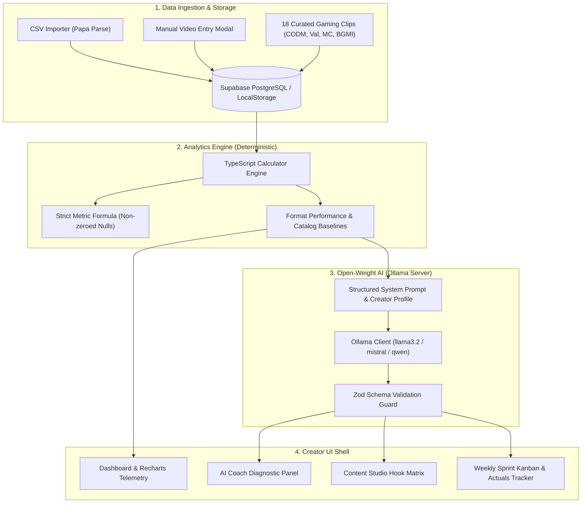

# CreatorCoach AI — Gaming Creator Growth Coach

<div align="center">

[](https://nextjs.org/)
[](https://www.typescriptlang.org/)
[](https://tailwindcss.com/)
[](https://ollama.com/)
[](https://supabase.com/)
[](file:///tests)
[](LICENSE)

<br />

**Turn Every Clip Into Your Next Big Move.**  
A modern, dark-themed creator SaaS co-pilot engineered for gaming creators publishing short-form video on **YouTube Shorts** and **Instagram Reels**.

[Explore Features](#key-features) • [Architecture](#system-architecture) • [Quick Start](#quick-start) • [Ollama Setup](#open-weight-ai-setup-ollama) • [Database](#database-schema--migrations) • [API Reference](#api-endpoints)

</div>

---

## Executive Overview

**CreatorCoach AI** solves the core challenge faced by emerging gaming creators: vanity metrics that offer zero actionable insights. Rather than generic chatbots or black-box "viral hacks," CreatorCoach AI pairs **deterministic statistical analytics** with **structured open-weight AI inference (Ollama)** to diagnose performance trends, generate retention-engineered scripts, and manage a hypothesis-driven weekly content sprint.

Built from the ground up with high-contrast midnight tones, electric violet-to-cyan gradient accents, responsive Recharts telemetry, and zero fake functionality.

Supported games include:
- **CODM (Call of Duty: Mobile)** — *Ranked MP, Battle Royale, loadout meta, clutch highlights, and slide-cancel aim guides*
- **Valorant** — *Clutch highlights, lineup guides, and economy management*
- **Minecraft** — *Redstone tutorials, survival challenges, and speedruns*
- **BGMI** — *Zone rotations, airdrop rushes, and clutch plays*
- **Apex Legends**, **GTA V**, and **Custom / Other Games**

---

## Key Features

### 1. Deterministic Analytics Engine
- **Strict Mathematical Integrity**: Evaluates performance purely via transparent TypeScript functions. Missing metrics are omitted from averages rather than coerced to zero, avoiding baseline skew.
  $$\text{Engagement Rate} = \frac{\text{likes} + \text{comments} + \text{shares}}{\text{views}} \times 100$$
- **Format Performance Indexing**: Benchmarks each clip against the creator's historical catalog average to calculate performance multipliers ($1.4\times$, $0.8\times$) and detect format fatigue.
- **Interactive Telemetry**: Responsive Recharts area trajectories and segmented bar charts comparing formats (*Clutches*, *Tutorials*, *Fails*, *Updates*).

### 2. Epistemically Honest AI Coaching (Ollama)
- **Local Open-Weight Inference**: Powered by models such as `llama3.2:latest`, `mistral:7b`, or `qwen2.5:7b` through Ollama. Zero reliance on closed, proprietary AI APIs.
- **Observation vs. Hypothesis**: Explicitly separates observed statistical anomalies from causal hypotheses. Every recommendation is stamped with an empirical confidence level (*High*, *Medium*, *Exploratory*).
- **Zod Schema Enforced**: Strict server-side type validation guarantees structured JSON responses with zero markdown hallucinations.
- **Zero-Setup Demo Fallback**: Explore comprehensive diagnostic reports and sample concepts instantly without local Ollama prerequisites.

### 3. Content Studio & Hook Matrix
- **Hook Variations**: Generates 3 alternative opening angles for any concept:
  - *Shock / Disruption* (0–2s pattern interrupt)
  - *Curiosity Gap* (Intriguing mystery or bold claim)
  - *Action Climax* (Immediate high-stakes visual hook)
- **Full Production Outline**: Complete timestamped voiceover script, on-screen text overlays, scene-by-scene visual direction, platform-optimized hashtags, and Reels vs. Shorts adaptation notes.

### 4. Weekly Sprint Pipeline & Kanban
- **4-Stage Production Workflow**: *Concept Ideas* → *In Scripting* → *Recorded & Edited* → *Published & Tracking*.
- **Post-Publish Metrics Feedback Loop**: Once a video is published, creators record actual views, engagement rates, and qualitative outcome notes to validate or disprove the original test hypothesis.

### 5. Multi-Source Ingestion & Dual Persistence
- **CSV Import with Auto-Mapping**: Ingest exports from YouTube Studio or Instagram Insights with automatic column normalization and real-time validation warnings.
- **Dual Persistence Architecture**: Seamlessly operates in **Zero-Setup Local Demo Mode** (LocalStorage) or connects directly to **Supabase PostgreSQL** with Row-Level Security (RLS).

---

## System Architecture



---

## Application Pages & Layout

| Route | Page | Description |
| :--- | :--- | :--- |
| `/` | **Landing Page** | Visually striking 2-column hero with electric violet-cyan gradients, live interactive dashboard preview card, feature breakdowns, pricing tiers, and creator FAQ. |
| `/dashboard` | **Dashboard** | Personalized greeting, sprint progress counter, 4 metric panels, Recharts view trajectory, format breakdown charts, and AI coach spotlight. |
| `/analytics` | **Video Analytics** | Searchable video catalog, game/platform filters, CSV dropzone modal, manual clip editor, and explicit formula reference banner. |
| `/coach` | **AI Coach** | Diagnostic coaching interface with observed patterns, causal hypotheses, structured recommendations, and one-click *"Add to Planner"* buttons. |
| `/studio` | **Content Studio** | Script generator with game parameters, 3 hook angles (Shock, Curiosity, Action), scene-by-scene storyboard, and Reels vs. Shorts tabs. |
| `/planner` | **Weekly Planner** | 4-column sprint Kanban board with status badges, concept editor, and post-publish actual performance logger. |
| `/profile` | **Profile & Settings** | Channel handle, main games selector, target audience niche, weekly goals, live Ollama diagnostic tester, and Supabase status. |

---

## Directory Structure

```text
CreatorCoachAI/
├── src/
│   ├── app/
│   │   ├── (marketing)/
│   │   │   └── page.tsx              # Landing page with interactive preview
│   │   ├── analytics/page.tsx        # Video catalog & CSV import table
│   │   ├── coach/page.tsx            # AI Coach diagnostic interface
│   │   ├── dashboard/page.tsx        # Creator analytics dashboard
│   │   ├── planner/page.tsx          # 4-stage Weekly Sprint Kanban
│   │   ├── profile/page.tsx          # Creator profile & Ollama settings
│   │   ├── studio/page.tsx           # Content Studio script & hook matrix
│   │   ├── api/
│   │   │   ├── ai/coach/route.ts     # Ollama coaching report endpoint
│   │   │   ├── ai/health/route.ts    # Ollama connectivity test endpoint
│   │   │   ├── ai/planner/route.ts   # 5-concept sprint generator endpoint
│   │   │   ├── ai/studio/route.ts    # Short-form video script generator
│   │   │   ├── analytics/route.ts    # Server-side analytics calculation
│   │   │   └── videos/import/route.ts# CSV ingestion & normalization handler
│   │   ├── globals.css               # Midnight dark design tokens & glass styles
│   │   └── layout.tsx                # Root layout with Geist font configuration
│   ├── components/
│   │   ├── layout/
│   │   │   ├── AppShell.tsx          # Master shell wrapping internal pages
│   │   │   ├── Sidebar.tsx           # Collapsible glowing sidebar
│   │   │   └── Topbar.tsx            # Breadcrumbs, quick actions & avatar
│   │   ├── ui/
│   │   │   ├── GameBadge.tsx         # Game-specific accent badges
│   │   │   ├── MetricCard.tsx        # Stat cards with ambient radial glow
│   │   │   └── PlatformBadge.tsx     # Shorts & Reels indicator badges
│   │   ├── AnalyticsCharts.tsx       # Recharts dual-area & bar visualizers
│   │   ├── CsvImportModal.tsx        # Drag-and-drop CSV importer with auto-mapping
│   │   ├── Logo.tsx                  # Custom vector gaming brand icon
│   │   └── VideoModal.tsx            # Add/Edit video record modal
│   ├── lib/
│   │   ├── ai/ollama.ts              # Robust Ollama HTTP client with timeout
│   │   ├── analytics/calculator.ts   # Pure TypeScript deterministic math engine
│   │   ├── data/
│   │   │   ├── sample-gaming-data.ts # Authentic seed records (CODM, Val, MC, BGMI)
│   │   │   └── storage.ts            # Client-side data store with storage events
│   │   ├── supabase/client.ts        # Supabase client with graceful fallback
│   │   └── utils.ts                  # Number formatting and Tailwind utilities
│   └── types/index.ts                # TypeScript domain models and Zod schemas
├── supabase/
│   └── schema.sql                    # Production PostgreSQL DDL with RLS policies
├── tests/
│   ├── ai-schema.test.ts             # Zod schema validation test suite
│   ├── analytics.test.ts             # Pure math and non-zeroed null tests
│   └── csv-validation.test.ts        # CSV parsing and game normalization tests
└── README.md
```

---

## Quick Start

### 1. Prerequisites
- **Node.js**: v18.17+ or v20+ / v22+
- **npm**, **pnpm**, or **yarn**
- *(Optional)* **Ollama**: For executing open-weight models locally

### 2. Installation
Clone the repository and install dependencies:
```bash
git clone https://github.com/bhavya277/CreatorCoachAI.git
cd CreatorCoachAI
npm install
```

### 3. Environment Configuration
Copy `.env.example` to `.env.local`:
```bash
cp .env.example .env.local
```

Configure your variables in `.env.local`:
```env
# Optional: Supabase PostgreSQL (runs in Zero-Setup Demo Mode if omitted)
NEXT_PUBLIC_SUPABASE_URL=https://your-project.supabase.co
NEXT_PUBLIC_SUPABASE_ANON_KEY=your-anon-key

# Optional: Ollama Open-Source AI (defaults to local Ollama daemon)
OLLAMA_BASE_URL=http://127.0.0.1:11434
OLLAMA_MODEL=llama3.2:latest
OLLAMA_TIMEOUT_MS=30000
```

### 4. Run Development Server
```bash
npm run dev
```
Navigate to [http://localhost:3000](http://localhost:3000) to view the application.

---

## Open-Weight AI Setup (Ollama)

CreatorCoach AI is designed exclusively for open-weight models to ensure complete privacy and zero API costs.

### Recommended Models
| Model | Size | Recommended Use Case |
| :--- | :--- | :--- |
| **`llama3.2:latest`** *(Recommended)* | 3B | High-speed inference, snappy hook generation, low memory footprint |
| **`llama3.1:8b`** | 8B | Deep qualitative reasoning and complex narrative outlines |
| **`mistral:7b`** | 7B | Punchy, natural conversational dialogue and script pacing |
| **`qwen2.5:7b`** | 7B | Precise JSON formatting and structured diagnostic reasoning |

### Running Ollama Locally:
1. Install Ollama from [ollama.com](https://ollama.com).
2. Pull your model:
   ```bash
   ollama pull llama3.2
   ```
3. Start the daemon:
   ```bash
   ollama serve
   ```
4. Verify connectivity: Navigate to `/profile` in CreatorCoach AI and click **"Test Connection"**.

> **Zero-Setup Demo Mode**: If you do not have Ollama installed, every AI feature includes an instant fallback (`Sample Concepts`, `Load Demo Report`, `Generate Sample Script`) with realistic gaming creator data.

---

## Database Schema & Migrations

If you choose to enable persistent cloud storage, Supabase PostgreSQL schemas with Row-Level Security (RLS) are provided in `supabase/schema.sql`.

### Tables Created:
1. `profiles`: Creator handles, primary gaming niche, main games, weekly targets, and model configs.
2. `videos`: Clip metrics including views, likes, comments, shares, watch duration, and platform.
3. `video_metrics`: Time-series metric snapshots for historical performance auditing.
4. `coaching_reports`: Stored AI coaching reports, evidence baselines, and hypotheses.
5. `content_ideas`: 4-stage sprint planner concepts and post-publish actual results.
6. `content_experiments`: Concrete testable experiments linked to video concepts.

### Applying Schema:
1. Create a project at [supabase.com](https://supabase.com).
2. Open the **SQL Editor** in the Supabase Dashboard.
3. Paste the contents of `supabase/schema.sql` and run.
4. Add your `NEXT_PUBLIC_SUPABASE_URL` and `NEXT_PUBLIC_SUPABASE_ANON_KEY` to `.env.local`.

---

## API Endpoints

| Method | Endpoint | Description |
| :--- | :--- | :--- |
| `POST` | `/api/ai/coach` | Evaluates creator video catalog via Ollama and outputs structured coaching diagnosis. |
| `POST` | `/api/ai/studio` | Generates 3 hook variations, spoken script, and scene outline for a specific game and format. |
| `POST` | `/api/ai/planner` | Synthesizes a 5-video weekly sprint pipeline based on catalog performance gaps. |
| `GET` | `/api/ai/health` | Tests reachability and lists available models from the specified Ollama endpoint. |
| `POST` | `/api/analytics` | Computes deterministic averages, engagement rates, and format breakdowns. |
| `POST` | `/api/videos/import` | Ingests CSV video datasets, normalizes fields, and flags missing metrics. |

---

## Quality Assurance & Testing

The project includes unit tests executed using Node 22's native test runner (`--experimental-strip-types`):

```bash
# Run the complete test suite
npm test

# Run TypeScript type verification
npx tsc --noEmit

# Run Next.js production build verification
npm run build
```

### Verified Test Matrix:
- **`tests/analytics.test.ts`**: Verifies strict engagement calculation math, zero-view handling, and non-zeroed null preservation.
- **`tests/ai-schema.test.ts`**: Verifies Zod validation for coaching reports, 5-concept weekly sprint constraints, and script generation schemas.
- **`tests/csv-validation.test.ts`**: Verifies quoted string CSV parsing, platform normalization, and game name mappings (CODM, Valorant, Minecraft, BGMI).

---

## License

This project is licensed under the [MIT License](LICENSE). Built for the gaming creator community.
